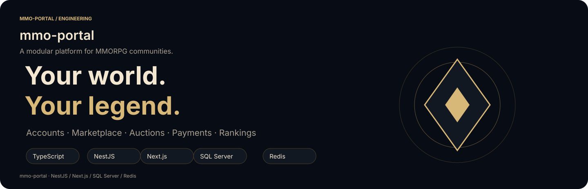
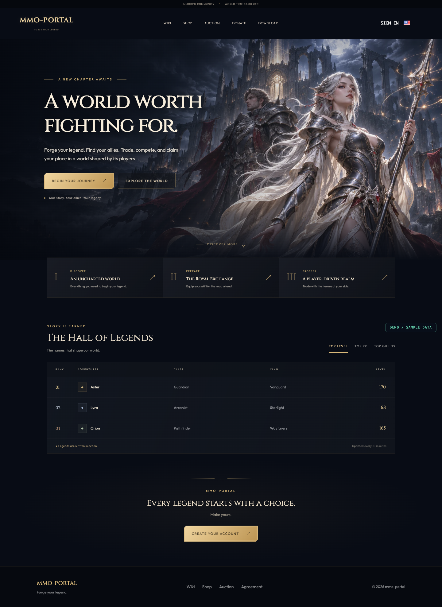
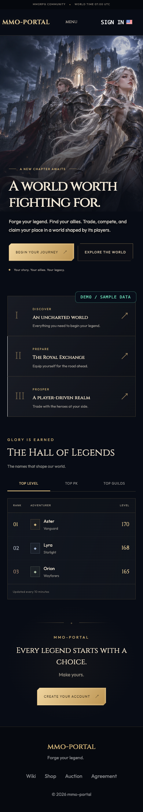
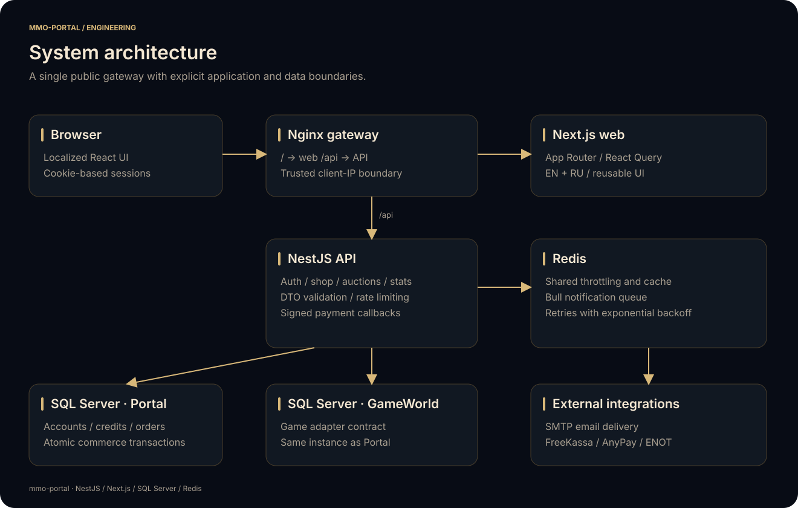
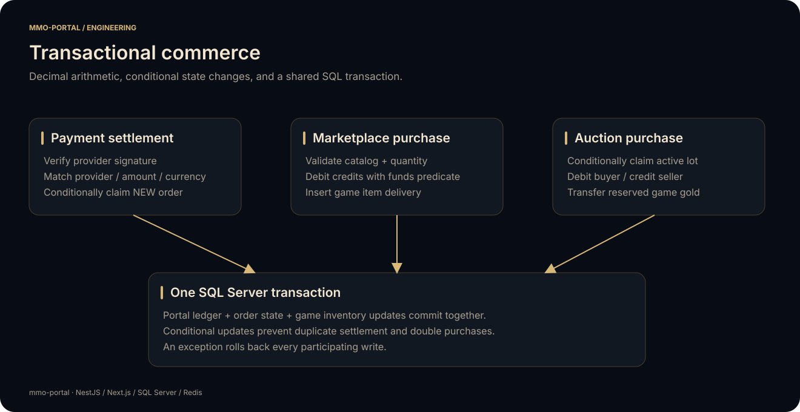

<p align="center"></p>

<p align="center">
  <a href="https://github.com/vadimoarturo/mmo-portal-nest/actions/workflows/ci.yml"></a>
  
  
  
  
</p>

# mmo-portal

A full-stack community platform for MMORPG servers: player accounts, a credit-based marketplace, player-to-player auctions, payment integrations, and public rankings. A modular NestJS API handles the business rules; a localized Next.js application provides the player experience.

The project keeps application source in `apps/` and portable deployment configuration in `deploy/`. SQL migrations and a small, inactive example catalog are included. Server distributions, live databases, backups, logs, certificates, credentials, and operational media stay outside the repository.

**Explore:** [API](apps/api/README.md) · [Web client](apps/web/README.md) · [Deployment](deploy/README.md) · [Architecture](docs/ARCHITECTURE.md) · [Contributing](CONTRIBUTING.md)

## Interface preview

The screenshots below are captured from the actual application. Ranking entries are synthetic demonstration data injected by the capture script; they do not represent real players or a running production server.

<p align="center"></p>
<details>
<summary>View the mobile preview</summary>
<p align="center"></p>
</details>

## Capabilities

| Area | What the platform does |
| --- | --- |
| Accounts | Registration, bcrypt password hashes, email verification, cookie sessions, password recovery, and referral codes |
| Marketplace | Server-aware categories, paginated inventory, sale prices, quantity rules, and game item delivery |
| Auctions | List game gold for portal credits, browse listings, buy another player's lot, and cancel your own listing |
| Payments | FreeKassa, AnyPay, and ENOT adapters, signed callbacks, exchange rates, minimum amounts, and tiered bonuses |
| Rankings | Public player, competitive, and guild leaderboards with cached server queries |
| Notifications | Handlebars email templates delivered through a Redis-backed Bull queue with retries |
| Localization | English and Russian content, locale-aware routes, translated validation messages, and metadata |
| Operations | Non-root containers, an Nginx gateway, explicit database migrations, dependency lockfiles, and CI checks |

## Architecture

<p align="center"></p>

Nginx routes browser traffic to Next.js and `/api/` traffic to NestJS. The API owns account, catalog, order, and wallet records in the **Portal** database. A game adapter reads character and guild data from **GameWorld** and performs game inventory writes inside the portal's transaction.

**Both databases use the same SQL Server instance.** This is an architectural requirement for atomic commerce: wallet changes, order state, and game delivery participate in one database transaction. The adapter validates the connection origins and catalog identifier before a cross-catalog write.

Redis serves three separate responsibilities: cached query results, shared request throttling, and queued email delivery. Payment providers and SMTP are accessed only by the API.

See [architecture and domain contracts](docs/ARCHITECTURE.md) for module responsibilities, transaction boundaries, data relationships, and extension points.

## Repository layout

```text
apps/
  api/                  NestJS application, Prisma schema, migrations, seed, unit tests
  web/                  Next.js App Router application, UI, translations, static assets
deploy/                Dockerfiles, Compose stack, Nginx, environment example
docs/                  Architecture reference, SVG diagrams, interface screenshots
scripts/               Release audit, diagram generation, preview capture
.github/               CI workflow, dependency update configuration, PR template
```

The applications have independent `pnpm-lock.yaml` files. Root scripts orchestrate their commands; this repository does not use a shared pnpm workspace or publish npm packages.

## Requirements

- Node.js 22 and pnpm 9.4.0. `.nvmrc`, package metadata, CI, and container builds use this toolchain.
- SQL Server with a **Portal** catalog and a **GameWorld** catalog on the same instance.
- A game database exposing the [adapter contract](docs/ARCHITECTURE.md#game-database-contract).
- Redis 7, an SMTP account, and provider credentials for the integrations you enable.
- Docker with Compose v2 for the container workflow.

A frontend preview can run independently of the API. Full account, marketplace, payment, and game functionality requires the corresponding services and credentials.

## Local setup

```bash
git clone https://github.com/vadimoarturo/mmo-portal-nest.git
cd mmo-portal-nest
nvm use
corepack enable
corepack prepare pnpm@9.4.0 --activate
pnpm install --frozen-lockfile
pnpm install:apps
cp apps/api/.env.example apps/api/.env
cp apps/web/.env.example apps/web/.env
```

Edit the two local environment files. The examples use `localhost`, `example.com`, and sample catalog names; they contain no working credentials. Generate three independent JWT signing secrets with `openssl rand -hex 32` and fill in SQL, SMTP, and provider settings.

1. Provision the empty Portal catalog and the game schema using your SQL Server administration tools.
2. Set `DATABASE_URL` and `DATABASE_URLMMO` to catalogs on that same SQL Server instance. The portal database login needs the game table permissions required by the adapter.
3. Apply the portal schema and seed:

```bash
pnpm --dir apps/api build
pnpm --dir apps/api db:migrate
pnpm --dir apps/api db:seed
```

The seed is repeatable. It creates a server, example category/item, and payment provider records. The sample item and payment methods start **disabled**, so example credentials cannot be used for checkout.

Start each application in its own terminal:

```bash
pnpm dev:api
pnpm dev:web
```

The frontend runs at `http://localhost:3000`; the API uses `http://localhost:3010/api`. Use the localhost origin consistently when exercising cookie authentication. Production traffic uses HTTPS.

## Configuration

| File | Purpose |
| --- | --- |
| `apps/api/.env.example` | Database URLs, Redis, SMTP, JWT secrets, provider credentials, allowed web origin |
| `apps/web/.env.example` | Public API origin and optional community/download links |
| `deploy/.env.example` | Reverse proxy port and the public API origin compiled into the web image |

The HTTP client appends `/api` to `NEXT_PUBLIC_API_URL`: set an origin such as `https://portal.example.com`, without an `/api` suffix. `NEXT_PUBLIC_*` settings are public build inputs and require a web rebuild when changed. Keep all secrets in API runtime configuration.

Community links disappear when their public environment values are empty. The source ships an original neutral emblem and no server-specific media. Operators can mount their own catalog images under `deploy/cdn/`; see the [web asset contract](apps/web/README.md#assets-and-branding).

## Transactional commerce

<p align="center"></p>

- Wallet arithmetic uses fixed decimal precision. Debits are conditional SQL updates that cannot overdraw the account.
- A callback must match the stored payment provider, amount, and currency. A conditional order transition prevents duplicate credits, and completed callbacks are acknowledged without another increment.
- A marketplace purchase validates the active server and item, debits credits, records the purchase, and inserts game delivery within one transaction.
- An auction purchase conditionally claims the active lot, debits the buyer, credits the seller, and transfers the reserved gold within one transaction. A cancel operation uses the same state-transition discipline.

## Verification

```bash
pnpm lint             # Both applications; warnings fail the check
pnpm typecheck        # TypeScript, including Prisma generation for API types
pnpm test             # API unit and regression tests
pnpm build            # API build and standalone web bundle
pnpm audit:prod       # Registry advisory checks for production dependencies
pnpm check:release    # Publication paths, file sizes, branding, and credential checks
```

Tests cover wallet precision and insufficient funds; payment amount/provider matching and repeated callbacks; auction ownership and competing claims; safe game SQL parameters; webhook signatures; password recovery; and session revocation. They use isolated fixtures and require no live database or payment account.

GitHub Actions runs these checks on pushes and pull requests. No deployment or production credentials are needed for CI. [Contributing](CONTRIBUTING.md) explains how to run and extend the checks.

## Deployment

The Compose stack contains `api`, `web`, `redis`, and `nginx`. Only the gateway publishes a host port. API secrets are injected at runtime; the web container serves Next.js standalone output as a non-root user.

```bash
cp deploy/.env.example deploy/.env
mkdir -p deploy/cdn
docker compose --env-file deploy/.env -f deploy/compose.yml build
docker compose --env-file deploy/.env -f deploy/compose.yml run --rm api pnpm db:migrate
docker compose --env-file deploy/.env -f deploy/compose.yml run --rm api pnpm db:seed
docker compose --env-file deploy/.env -f deploy/compose.yml up -d
```

Configure SQL connectivity, public origins, credentials, and HTTPS before serving a real community. The [deployment guide](deploy/README.md) documents container networking, schema rollout, configuration changes, and routine operations.

## Documentation assets

SVG diagrams are editable text assets generated by `python3 scripts/generate-diagrams.py`. Desktop and mobile previews can be reproduced with Playwright; see [scripts](scripts/README.md). All preview player names and guilds are fictional.

## License

No project license has been granted. Dependency licenses remain with their respective authors.
