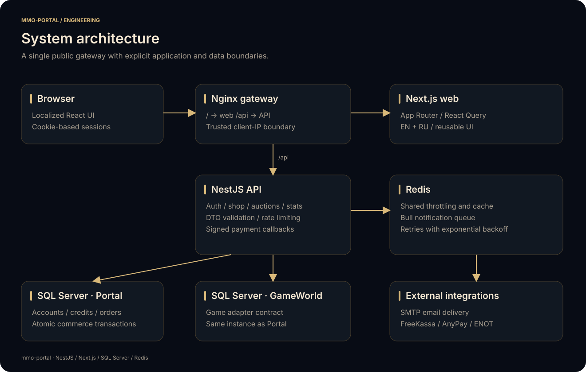

# Application source

`mmo-portal` is split into independently installable backend and frontend applications. They communicate over HTTP and share domain vocabulary, not a runtime package or a generated database client.

| Application | Responsibility | Guide |
| --- | --- | --- |
| `api/` | Authentication, persistence, commerce, payment callbacks, game adapter, rankings, and notifications | [API README](api/README.md) |
| `web/` | Locale-aware player interface, client state, forms, API requests, and browser assets | [Web README](web/README.md) |

<p align="center"></p>

## Working from the repository root

```bash
pnpm install:apps
pnpm dev:api          # Terminal 1
pnpm dev:web          # Terminal 2
pnpm lint
pnpm typecheck
pnpm test
pnpm build
```

Each application owns its dependency lockfile, TypeScript configuration, lint configuration, and environment example. Install dependencies with `--frozen-lockfile`; update the relevant lockfile whenever dependency declarations change.

The API's `src/common/enum/` and the web client's `types/enum/` describe the HTTP contract. Change both sides when renaming a server identifier, currency field, category, or business error. The abstract server key is `MMO`; monetary fields are named `credits` and `gold`.

Deployment configuration lives in [`deploy/`](../deploy/README.md). Runtime secrets, database contents, and server media do not belong in either application's source tree.
