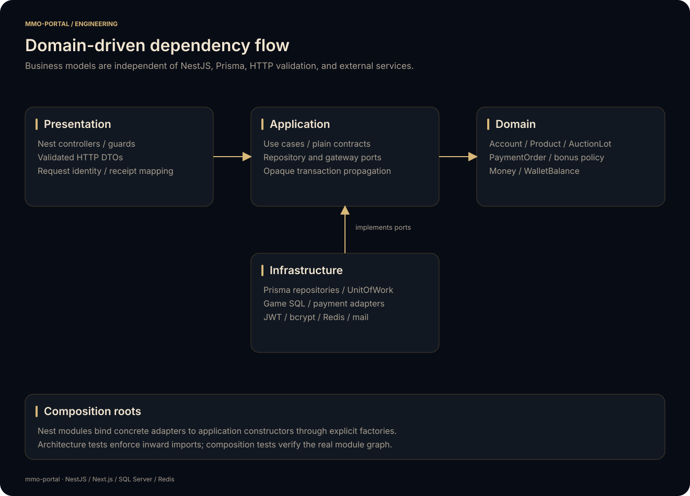
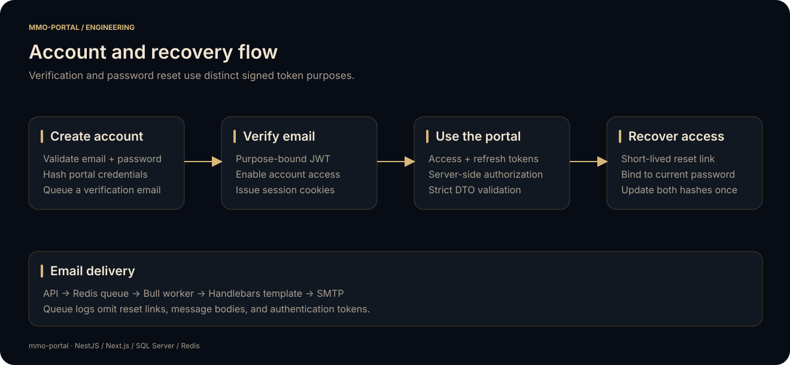
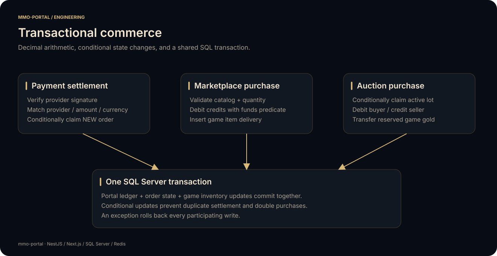
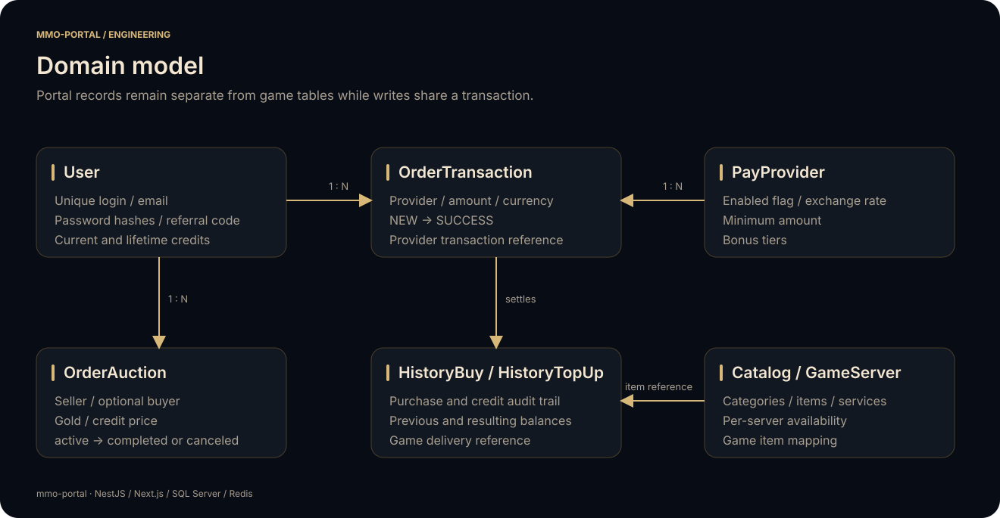

# mmo-portal API

The NestJS backend owns player identity, portal credits, catalog browsing, purchases, auction settlement, payment callbacks, public rankings, and queued email. It exposes a validated JSON API under `/api` and integrates game data through a dedicated SQL adapter.

[Project overview](../../README.md) · [Architecture](../../docs/ARCHITECTURE.md) · [Web client](../web/README.md) · [Deployment](../../deploy/README.md)

## Domain-driven structure

The API is a modular monolith with explicit bounded contexts. Domain models and application scenarios are plain TypeScript; NestJS composes HTTP adapters, repositories, and gateways at each context's module boundary.

<p align="center"></p>

```text
src/
  contexts/
    identity/           Accounts, verification, credentials, session issuance
    wallet/             Portal credit transfers and balance checks
    catalog/            Product pricing, checkout, catalog projections
    auctions/           Gold reservations and listing lifecycle
    payments/           Payment quotes, receipt matching, bonus settlement
    rankings/           Public leaderboard projections
    game-integration/   Game gateway and SQL anti-corruption adapter
  shared/
    domain/             Money, business vocabulary, domain failures
    application/        Opaque transaction context and UnitOfWork port
    http/               Cookie vocabulary
    decorator/          Authenticated request extraction
    exception/          HTTP exception mapping
    interceptor/        Request timing
  platform/
    config/             Validated runtime configuration
    prisma/             Client lifecycle and UnitOfWork implementation
    cache/              Redis cache adapter
    queue/              Bull worker, email templates, retry policy
  bootstrap/            Shared resource/module composition
  app.module.ts         Context assembly and global rate limiting
prisma/
  schema.prisma         Persistence model, separate from domain models
  migrations/           Versioned database schema
  seed.ts               Repeatable configuration seed
```

Core contexts contain `domain/`, `application/`, `infrastructure/`, and, where applicable, `presentation/http/`. Read-only rankings and the game integration expose application ports without artificial aggregates. Context READMEs describe their specific contracts: [identity](src/contexts/identity/README.md), [wallet](src/contexts/wallet/README.md), [catalog](src/contexts/catalog/README.md), [auctions](src/contexts/auctions/README.md), [payments](src/contexts/payments/README.md), [rankings](src/contexts/rankings/README.md), and [game integration](src/contexts/game-integration/README.md).

Application services receive repository/gateway interfaces through constructors. Nest module factories bind these interfaces to concrete adapters. Domain code imports no NestJS, Prisma, Redis, HTTP DTO validation, or payment SDK. Automated architecture tests enforce dependency direction and context boundaries; a composition test resolves the real context modules with external resources replaced.

`AppModule` initializes validated configuration and registers global DTO validation, exception mapping, request timing, CORS for `WEB_URL`, and an `/api` prefix. See the [DDD design guide](../../docs/DDD.md) for ownership, ubiquitous language, transaction design, and extension examples.

## Identity and sessions

<p align="center"></p>

Registration stores bcrypt hashes for portal and game authentication, creates a referral code using cryptographic randomness, records the session metadata, and queues a verification email. The public schema contains no plaintext password column.

Access and refresh JWTs use independent secrets. Sessions carry a credential fingerprint that is checked against the current password hash, so changing a password revokes previously issued sessions. The guard refreshes an expired access token only after validating the refresh token and current credentials.

Verification JWTs have an explicit purpose. An email verification token cannot be used as a password reset token. Recovery links are tied to the current password hash; a conditional credential update prevents the same link from resetting a password twice. Password changes update both stored bcrypt hashes.

The notification worker renders a Handlebars template and sends it through SMTP. Queue registration, injection, and processing share a stable queue name. Failed email jobs use bounded attempts and exponential backoff. Logs omit email bodies, reset links, request/response payloads, cookies, and query strings.

## Commerce and consistency

<p align="center"></p>

The wallet service accepts decimal strings, validates a positive amount, and executes conditional `DECIMAL(19, 2)` updates. SQL `OUTPUT` returns the actual previous and resulting balances for audit entries. An opaque `TransactionContext` can be passed to the wallet application port so settlement never opens a separate transaction. Only infrastructure unwraps the underlying Prisma client.

Marketplace purchases validate the active catalog/server relationship, quantity limits, and stackability. Price multiplication uses the immutable `Money` value object, backed by an isolated `decimal.js` constructor. The debit, purchase audit record, and game inventory insert share one transaction.

Auction listing creation removes game gold and inserts the listing in the same transaction. Buying a lot conditionally changes its state from `active` to `completed`, then settles both portal wallets and the buyer's game wallet. Canceling a lot conditionally changes `active` to `canceled` and returns the reserved gold. Competing state changes cannot both claim the same listing.

Payment callbacks are authenticated by provider-specific guards. ENOT uses its documented HMAC-SHA256 canonical JSON signature, including nested custom fields. Settlement matches the provider, currency, and exact expected amount before claiming a `NEW` order. An already successful order is acknowledged without another credit; a losing concurrent claim does not increment a wallet.

**SQL deployment contract:** Portal and GameWorld must be catalogs on the same SQL Server instance. Game writes use fully qualified, validated catalog/table identifiers and bound values through the portal transaction. A connection to another instance is rejected before a game write.

## HTTP endpoints

All paths below are relative to `/api`. Mutating endpoints use the DTOs alongside their controllers. Authenticated routes read identity from the server-validated session, rather than a login supplied in the request body.

| Method | Path | Purpose |
| --- | --- | --- |
| POST | `/auth/signup` | Create a player account and queue verification |
| POST | `/auth/signin` | Validate credentials and set session cookies |
| POST | `/auth/logout` | Clear session cookies |
| POST | `/auth/verify/email` | Confirm a purpose-bound verification token |
| GET | `/auth/verify/email/resend` | Queue another verification email |
| POST | `/auth/password/resend` | Request a recovery email |
| POST | `/auth/verify/password` | Apply a one-use recovery token and update credentials |
| GET | `/user/balance` | Read the authenticated player's portal credits |
| GET | `/shop/category` | Read enabled servers and categories |
| POST | `/shop/items` | Read one catalog page |
| POST | `/shop/buy` | Purchase and deliver an item atomically |
| POST | `/auction/lots` | Browse active listings |
| POST | `/auction/lots/my` | Browse the authenticated player's listings |
| POST | `/auction/create` | Reserve game gold and create a listing |
| POST | `/auction/buy` | Settle a player-to-player purchase |
| POST | `/auction/cancel` | Cancel a listing and return gold |
| GET | `/pay/list` | Read enabled payment methods and bonus tiers |
| POST | `/pay/create` | Create a provider payment request |
| POST | `/webhook/freekassa` | Process a FreeKassa callback |
| POST | `/webhook/anypay` | Process an AnyPay callback |
| POST | `/webhook/enot` | Process an ENOT callback |
| GET | `/top/players` | Read the public player leaderboard |
| GET | `/top/pks` | Read the public competitive leaderboard |
| GET | `/top/guilds` | Read the public guild leaderboard |

Example catalog request:

```json
{ "serverName": "MMO", "categoryId": "other", "page": 1 }
```

Example auction listing:

```json
{ "serverName": "MMO", "gold": "1000000", "credits": "25.50" }
```

Portal credit amounts are decimal strings; game gold amounts are integer strings. Successful HTTP responses follow each controller's response DTO. Business errors include a stable `code`; unexpected internal errors return a generic 500 response.

## Configuration reference

Copy `.env.example` to `.env` for local work. All values below belong to API runtime configuration.

| Setting | Meaning |
| --- | --- |
| `APP_PORT` | HTTP listener, default `3010` |
| `WEB_URL` | Allowed browser origin and email-link origin |
| `DATABASE_URL` | Portal SQL Server connection URL |
| `DATABASE_URLMMO` | Game catalog URL on the same SQL Server instance |
| `REDIS_HOST`, `REDIS_PORT` | Shared cache, throttling, and queue connection |
| `JWT_SECRET_ACCESS`, `JWT_SECRET_REFRESH`, `JWT_SECRET_VERIFY` | Independent signing keys, at least 32 characters |
| `JWT_SECRET_*_EXPIRESIN` | Positive duration with `s`, `m`, `h`, or `d` suffix |
| `SMTP_HOST`, `SMTP_PORT`, `SMTP_SECURE` | SMTP transport; port 465 uses implicit TLS |
| `SMTP_USER`, `SMTP_PASS` | Sender identity and SMTP credentials |
| `FREEKASSA_SHOP_ID`, `FREEKASSA_SECRET_ONE`, `FREEKASSA_SECRET_TWO` | FreeKassa integration |
| `ANYPAY_SHOP_ID`, `ANYPAY_SECRET` | AnyPay integration |
| `ENOT_SHOP_ID`, `ENOT_SECRET_ONE`, `ENOT_SECRET_TWO` | ENOT invoice creation and webhook verification |

For port 587 SMTP, set `SMTP_SECURE=false` to use STARTTLS. Use certificate validation for SQL and SMTP in production. The example's SQL `trustServerCertificate=true` is for local self-signed development certificates.

Nginx overwrites forwarding headers, and the API trusts the private proxy network. Expose the API through that gateway, keeping its direct port private. Provider IP checks use the resolved request IP, not an arbitrary `X-Real-IP` header sent by a caller.

## Schema and seed

<p align="center"></p>

```bash
pnpm install --frozen-lockfile
cp .env.example .env
# Fill local configuration, then:
pnpm build
pnpm db:migrate
pnpm db:seed
pnpm start:dev
```

The seed shares one Prisma client and closes it reliably. It upserts the abstract `MMO` server, a small example catalog, and provider metadata. Existing records retain operator-controlled activation settings. Example checkout entries are disabled on creation.

`db:migrate` applies the committed portal baseline to a newly provisioned catalog. The game database is supplied by the server operator and follows the [game contract](../../docs/ARCHITECTURE.md#game-database-contract).

## Development and verification

| Command | Action |
| --- | --- |
| `pnpm start:dev` | Watch source changes |
| `pnpm prisma:generate` | Regenerate Prisma types without changing the database |
| `pnpm typecheck` | Generate Prisma types and check TypeScript |
| `pnpm lint` | Run ESLint with zero allowed warnings |
| `pnpm test -- --runInBand` | Run the unit and regression suite |
| `pnpm test:cov -- --runInBand` | Generate coverage under ignored `coverage/` |
| `pnpm build` | Generate Prisma and compile application/seed output |
| `pnpm start:prod` | Run `dist/src/main.js` |

Unit tests run with mocked transaction boundaries and local fixtures. The ENOT signature test uses a public vendor test vector. Session tests sign and verify real JWTs; password recovery tests validate real bcrypt hashes. No test sends email, charges a payment method, or connects to a live game database.

Production imports use Node's package `imports` map, matching TypeScript's source aliases and Jest's test mappings. Container startup runs only the application; schema changes and seed execution remain explicit deployment steps.

## Integration references

- [ENOT webhook signature specification](https://docs.enot.io/e/new/webhook)
- [Next.js November 2026 security release](https://nextjs.org/blog/november-2026-security-release)
- [Prisma SQL Server connector](https://www.prisma.io/docs/orm/overview/databases/sql-server)
