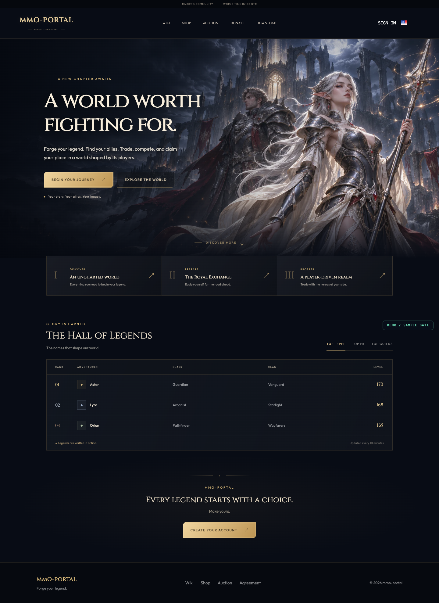
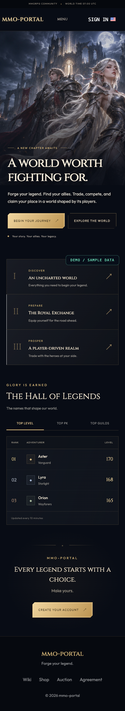

# mmo-portal web client

A responsive Next.js App Router application for player accounts, marketplace browsing, credit top-ups, player auctions, community guides, and public rankings. English and Russian share the same component structure and API contract.

[Project overview](../../README.md) · [API](../api/README.md) · [Deployment](../../deploy/README.md)

<p align="center"></p>

## Frontend structure

```text
app/
  [locale]/             Localized routes, layouts, metadata, styles
features/
  identity/             Account dialogs, recovery, verification, HTTP contracts
  wallet/               Balance HTTP client
  catalog/              Shop views, purchase dialog, catalog HTTP contracts
  auctions/             Listing views, confirmation dialogs, auction client
  payments/             Top-up dialog, provider HTTP client and contracts
  rankings/             Leaderboard presentation, HTTP client and contracts
components/
  Content/              Shared header, footer, welcome, guides, static content
  UI/                   Reusable input, button, select, modal shell, download dialog
core/
  providers/            Auth/session display, notifications, modal composition
  services/api/         Shared Axios transport
  helpers/              Validation patterns, item formatting, error translation
i18n/locales/           English and Russian namespaces
types/                  Shared enums and error contracts
public/images/          Original emblem and fantasy hero artwork
scripts/                Standalone build preparation
```

Features align with the backend bounded contexts. Each feature owns its `infrastructure/api.ts` client, `contracts/` request/response types, and applicable `presentation/` views. All clients share a single transport for URL construction, credentials, and error handling. The route tree and shared providers compose these features.

The API owns monetary rules, authorization, and state transitions. The browser displays server state and collects input; it does not duplicate settlement aggregates or directly import backend persistence models. See the [DDD guide](../../docs/DDD.md#web-client-boundary).

The locale layout initializes translations on the server and composes the client providers. Translated namespaces cover account forms, payments, shop, auctions, guides, SEO, navigation, and shared messages.

## Routes and user journeys

| Route | Experience |
| --- | --- |
| `/[locale]` | Community landing page and player/guild rankings |
| `/[locale]/shop` | Server/category selection, catalog pages, purchase dialog |
| `/[locale]/auction` | Active offers, creation form, purchase confirmation, own lots |
| `/[locale]/wiki` | Community guide with stable topic selection across languages |
| `/[locale]/agree` | Operator-facing terms content presented to players |
| `/[locale]/auth/sign-in` | Sign-in dialog |
| `/[locale]/auth/sign-up` | Account creation dialog |
| `/[locale]/auth/email-verify` | Verification token handling |
| `/[locale]/auth/password-change` | Recovery link and password update form |
| `/[locale]/pay/success` | Provider return feedback |
| `/[locale]/pay/error` | Provider failure/return feedback |

`middleware.ts` resolves locale routing. Both locales retain an explicit URL prefix (`prefixDefault: true`), including the default Russian locale, so direct cookie-free requests render without a rewrite/redirect cycle. The backend's email links omit an explicit locale and are routed through that middleware. A payment return page provides feedback; the signed backend callback is responsible for credit settlement.

## Client state and HTTP

- React Query owns asynchronous server state, query keys, mutation state, and catalog/ranking refreshes.
- The authentication provider reflects session metadata in navigation. The API's signed cookies and guards remain the source of authorization.
- The modal provider exposes stable show/hide actions so dependent effects can declare their dependencies safely.
- The notification provider displays localized results and owns its timers.
- `request.service.ts` builds `/api` URLs and sends credentials. DTO modules keep request/response shapes aligned with the backend.

Leaderboard tabs request the relevant dataset. The fixed-layout ranking table uses a compact three-column layout on phones, with clan names below player names, so the page stays within the viewport. The guide stores a numeric topic index so switching languages does not invalidate its selected component.

## Local development

```bash
pnpm install --frozen-lockfile
cp .env.example .env
pnpm start:dev
```

Open `http://localhost:3000/en` or `http://localhost:3000/ru`. Set `NEXT_PUBLIC_API_URL=http://localhost:3010` for a separately running API. The client adds the `/api` prefix itself.

For frontend-only presentation, the landing page and static content render without a game server. Live catalog, account, payment, and ranking requests are served by the configured API. The documented screenshots use the [capture script](../../scripts/README.md) to supply fictional ranking responses without a backend.

## Public build settings

| Variable | Purpose |
| --- | --- |
| `NEXT_PUBLIC_API_URL` | Browser-reachable API origin, without `/api` |
| `NEXT_PUBLIC_DISCORD_URL` | Optional community invite |
| `NEXT_PUBLIC_TELEGRAM_URL` | Optional community channel |
| `NEXT_PUBLIC_CLIENT_DOWNLOAD_URL` | Optional client download link |
| `NEXT_PUBLIC_CLIENT_TORRENT_URL` | Optional torrent download link |

These values are compiled into browser JavaScript. They are not secret, and changing them requires rebuilding the web bundle. Empty community/download values hide those links instead of linking to another deployment.

The app requests the Outfit and Cinzel fonts during the Next.js build. Allow access to the font provider when building. At runtime the generated font files are served by the app.

## Assets and branding

The product name is **mmo-portal**, with the tagline **Forge your legend.** The emblem is an original SVG under `public/images/`; the cinematic hero uses an original fantasy illustration, optimized as WebP. [Artwork provenance and prompt](../../docs/ARTWORK.md). No proprietary game screenshots, videos, launcher files, or server logos are included.

Catalog imagery follows a simple relative URL contract:

| Path | Intended asset |
| --- | --- |
| `/images/portal-mark.svg` | Included default community emblem |
| `/cdn/shop/<icon>.jpg` | Operator-supplied catalog item icon |
| `/cdn/shop/<image>.jpg` | Optional item detail artwork |
| `/cdn/pay/<provider-icon>.webp` | Operator-supplied payment method icon |

The container gateway serves these paths from the ignored `deploy/cdn/` mount. New deployments supply their own images when enabling catalog items or payment methods. Source changes are not needed to move the site to another hostname.

To change visible branding, update the Logo component, welcome content, metadata translations, and the original emblem together. Update both locale trees when changing translated copy. Configure operator terms in the `agree` namespaces before making the platform available to players.

## Production bundle

```bash
pnpm build
PORT=3000 HOSTNAME=127.0.0.1 pnpm start:prod
```

The build uses `output: 'standalone'`. A post-build script copies `public/` and `.next/static/` into the standalone server and removes any traced `.env` files. `start:prod` runs that prepared server directly.

The container build passes public settings as build arguments and starts the same standalone bundle. No local environment file is copied into the final image. Security headers include content-type protection, a referrer policy, and same-origin framing.

## Verification and previews

`typecheck` generates Next.js framework and route declarations before invoking TypeScript, so it also works in a clean checkout without prior build output.

```bash
pnpm lint
pnpm typecheck
pnpm build
```

The repository's API suite verifies the backend business contract. For a visual check, run the standalone web server and use the root preview command. The capture script blocks external requests, injects synthetic leaderboard entries, marks the screenshot as sample data, and saves desktop/mobile PNGs.

<p align="center"></p>

`pnpm smoke` starts the compiled standalone server on an ephemeral local port and checks cookie-free English/Russian routes, feature pages, artwork, and the root redirect. CI runs it after the production build.
