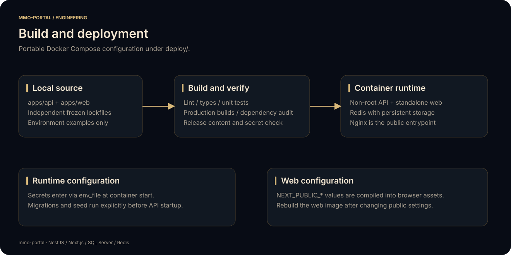

# Deploying mmo-portal

This directory contains the portable application deployment: Dockerfiles for the API and web client, a Compose stack, an Nginx gateway, and a public environment example. It contains no live infrastructure state, private keys, database exports, or server media.

[Project overview](../README.md) · [API configuration](../apps/api/README.md#configuration-reference) · [Architecture](../docs/ARCHITECTURE.md)

<p align="center"></p>

## Services and boundaries

| Service | Internal address | Responsibility |
| --- | --- | --- |
| `nginx` | Container port 80; host port `HTTP_PORT` | Public entrypoint, path routing, client IP boundary, optional CDN files |
| `web` | `web:3000` | Next.js standalone application |
| `api` | `api:3010` | NestJS API and business integrations |
| `redis` | `redis:6379` | Cache, throttling, and notification queue |

Only Nginx publishes a host port. Application services communicate by Compose service name. Redis keeps data in the named `redis-data` volume and reports readiness through its health check. The API waits for Redis health before starting.

SQL Server and SMTP are external services. Provision the Portal and GameWorld catalogs on **the same SQL Server instance**, and grant the API login the required rights in both. Cross-catalog inventory and wallet writes are then part of a single transaction.

## Directory contents

```text
Dockerfile.api          Multi-stage API build; non-root Node runtime
Dockerfile.web          Standalone Next.js build; non-root Node runtime
compose.yml             API, web, Redis, and Nginx services
nginx/default.conf      Generic proxy and static-asset routing
.env.example            Compose build origin and gateway port
cdn/                    Local operator assets, ignored by Git
```

Build contexts are the individual application directories. Dockerfile paths point back into `deploy/`; each application has its own `.dockerignore`. Dependencies use frozen lockfiles, and API builds generate Prisma before compiling.

## 1. Prepare configuration

From the repository root:

```bash
cp apps/api/.env.example apps/api/.env
cp deploy/.env.example deploy/.env
mkdir -p deploy/cdn
```

Fill every required API value. Generate three independent JWT secrets. For container networking, use a SQL hostname reachable **from the API container**; `localhost` inside a container refers to that container itself. Both SQL URLs must name the same host/port and different catalogs.

Compose overrides `REDIS_HOST=redis`, `REDIS_PORT=6379`, and `APP_PORT=3010` for the API. Set `WEB_URL` to the browser origin, such as `https://portal.example.com`.

`deploy/.env` configures:

```dotenv
PUBLIC_API_ORIGIN=https://portal.example.com
HTTP_PORT=8080
```

The optional `NEXT_PUBLIC_DISCORD_URL`, `NEXT_PUBLIC_TELEGRAM_URL`, `NEXT_PUBLIC_CLIENT_DOWNLOAD_URL`, and `NEXT_PUBLIC_CLIENT_TORRENT_URL` values can also be defined in `deploy/.env`. Compose forwards them as web build arguments. `apps/web/.env` is used for host development, not by the web container build.

Use production SQL certificates and set `trustServerCertificate=false`. Terminate HTTPS at an ingress/load balancer in front of the gateway, or adapt the Nginx configuration to your certificate management. Secure authentication cookies require HTTPS outside local development.

## 2. Build application images

```bash
docker compose --env-file deploy/.env -f deploy/compose.yml build
```

The API image includes compiled source, migrations, a compiled seed, and the CLI needed for explicit schema rollout. It starts `node dist/src/main.js` as the unprivileged `node` user.

The web image contains the standalone server, static chunks, and public assets. Browser configuration is fixed during this build. The runtime uses normal certificate verification; it does not disable TLS validation.

## 3. Apply the portal schema

Create the empty Portal database before applying its migration:

```bash
docker compose --env-file deploy/.env -f deploy/compose.yml run --rm api pnpm db:migrate
docker compose --env-file deploy/.env -f deploy/compose.yml run --rm api pnpm db:seed
```

The migration manages the Portal schema only. The GameWorld schema is an explicit [adapter contract](../docs/ARCHITECTURE.md#game-database-contract), supplied by your game service.

The seed can be run repeatedly. Sample items and payment providers are disabled on creation. Fill real provider configuration, add your game item mappings and catalog assets, and enable the entries you intend to offer.

Schema migration and seeding are not attached to the application entrypoint. Restarting an API container therefore does not alter schema or reapply catalog configuration automatically.

## 4. Start and inspect

```bash
docker compose --env-file deploy/.env -f deploy/compose.yml up -d
docker compose --env-file deploy/.env -f deploy/compose.yml ps
docker compose --env-file deploy/.env -f deploy/compose.yml logs --tail=100 api web nginx
```

With the example port, the gateway is available at `http://localhost:8080`. For a remote deployment, use the HTTPS origin configured above. Check the web homepage, a public ranking request, and the account email flow using your deployment's services.

## Gateway behavior

Nginx sends `/api/` to the API and all other application routes to Next.js. It overwrites `X-Real-IP` and `X-Forwarded-For` with the connection's remote address; callback authentication does not trust a caller-supplied forwarding header.

When placing another proxy in front of Nginx, configure real-IP handling for that proxy's **specific trusted addresses**. Otherwise Nginx will see the ingress address instead of the payment provider address. Keep direct API access private so clients cannot bypass the trust boundary.

Static files under `/cdn/` are served read-only from `deploy/cdn/` with directory listing disabled. `/gicon/` maps to its `gicon/` subdirectory. Hidden file paths are denied. The application source ships only a neutral public emblem; operator media is provisioned separately.

## Updates and operations

1. Pull the desired source revision and build replacement images.
2. Apply reviewed portal migrations as a separate operation.
3. Start the updated services and verify account, catalog, and callback behavior.
4. Retain your previous source/image revision for application rollback; manage database migrations according to your schema rollout policy.

Changing API secrets or runtime values requires recreating the API container. Changing a `NEXT_PUBLIC_*` value requires rebuilding the **web image**. Rotating signing secrets expires tokens signed with the old values.

Redis persistence belongs to the named volume. `docker compose down` retains it; removing volumes is a separate destructive action. Database backup policy, media provisioning, certificate storage, and secret rotation are managed outside the public source repository.

## Configuration validation

Validate the Compose document without using a private API environment file:

```bash
API_ENV_FILE=../apps/api/.env.example \
  docker compose -f deploy/compose.yml config --quiet
```

`API_ENV_FILE` is an override for validation or an alternate local secret-file location. Its path is resolved relative to `deploy/`. The example is a configuration template and must be filled before starting the API.
