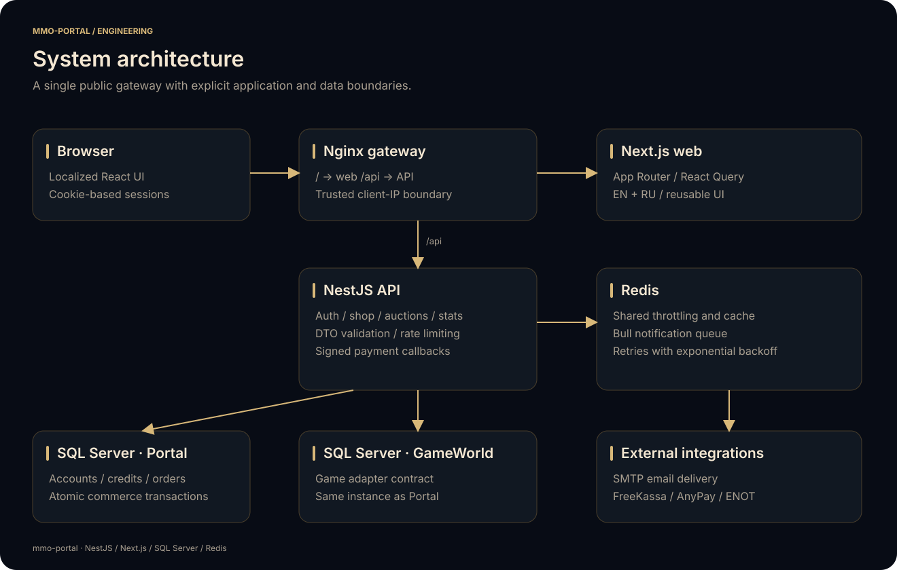
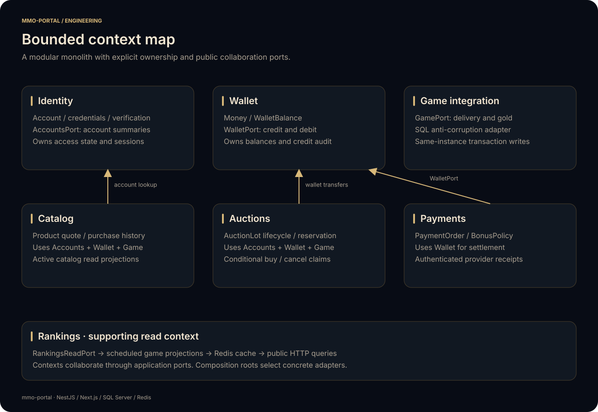
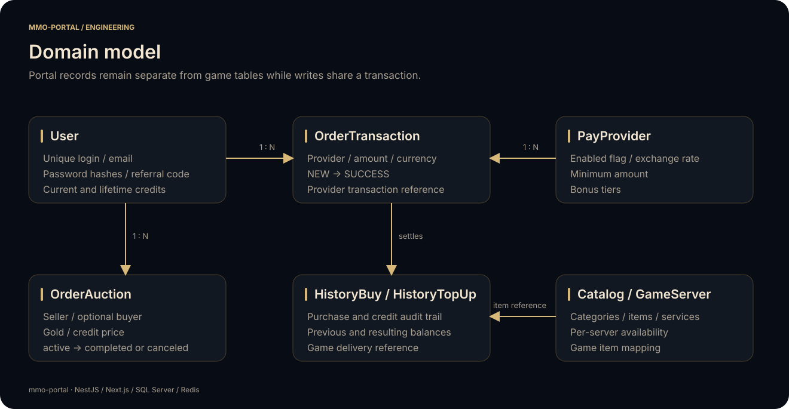
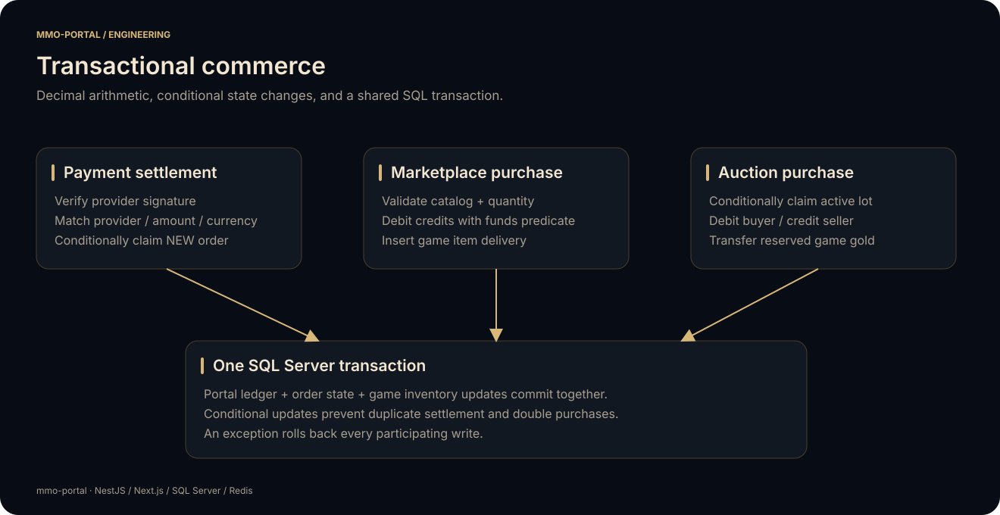
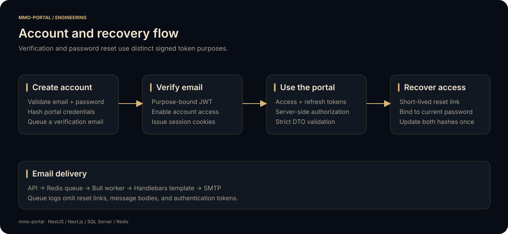

# Architecture and domain contracts

`mmo-portal` separates the browser experience, portal business rules, game integration, and deployment boundary. The API is the only application that writes account, money, order, or game delivery data.

[Project overview](../README.md) · [API](../apps/api/README.md) · [Web](../apps/web/README.md) · [Deployment](../deploy/README.md)

## System boundary

The browser communicates with a single public gateway. Next.js renders the localized interface. NestJS validates requests, authenticates sessions, and coordinates domain services. API credentials remain in runtime configuration; the frontend receives only public settings.

The API is a domain-driven modular monolith. Each bounded context owns its model, application ports/scenarios, and adapters. Nest modules are composition roots. Shared platform resources provide validated configuration, Prisma lifecycle, Redis cache, notification queue, and helpers. Game-specific SQL stays behind the game integration anti-corruption layer.

The [DDD guide](DDD.md) documents context ownership, layer rules, ubiquitous language, and transaction propagation.

## Data model

The Prisma schema is the source of truth for Portal records:

- `User` and `UserSession` hold player identity and session metadata.
- `GameServer`, `ShopCategory`, `ShopItem`, and `ShopService` describe the available catalog.
- `HistoryBuy` records item purchases and their financial context.
- `PayProvider` and `PayProviderBonus` describe rates, minimums, and bonus tiers.
- `OrderTransaction` tracks provider payment state and settlement references.
- `HistoryTopUp` records credit changes with previous and resulting balances.
- `OrderAuction` connects seller, optional buyer, server, reserved gold, and credit price.

Credit values are decimal strings at the HTTP boundary and in the existing domain schema. Calculations use domain `Money` and an isolated `decimal.js` constructor; wallet SQL explicitly casts to `DECIMAL(19, 2)`. Game gold uses positive integer amounts. The shared domain server key is `MMO`.

## Transaction boundary

Application scenarios pass the same opaque `TransactionContext` to repository, wallet, and game ports. `PrismaUnitOfWork` owns the transaction and infrastructure adapters unwrap its `Prisma.TransactionClient`. Wallet operations join the provided context instead of opening a nested transaction. Game writes qualify the validated GameWorld catalog through the same SQL connection.

| Operation | Records changed together |
| --- | --- |
| Top-up | Conditional payment order claim, wallet increment, credit audit record |
| Item purchase | Wallet debit, purchase record, game paid-item rows |
| Create auction | Game gold reservation, active listing |
| Buy auction | Conditional listing claim, buyer debit, seller credit/audit, game gold delivery |
| Cancel auction | Conditional listing state, returned game gold |

Conditional updates provide the concurrency gate. A debit includes a sufficient-funds predicate. A callback claims only a `NEW` order. Auction purchase/cancel operations claim only an `active` lot. A failed write raises an exception, so SQL Server rolls back the transaction rather than relying on an application-level refund sequence.

Portal and GameWorld must be on the **same SQL Server instance**. Use the same canonical host/port in both connection URLs. The API login used for Portal transactions needs permissions in the game catalog. Game catalog identifiers are restricted to letters, digits, and underscores, beginning with a letter or underscore; SQL values are bound parameters.

## Game database contract

The SQL adapter in `apps/api/src/contexts/game-integration/infrastructure/version/game-server-mmo.service.ts` integrates a game schema with the following tables. These are integration tables, not database backups or server distributions.

| Table | Columns used by the adapter | Purpose |
| --- | --- | --- |
| `Character` | `sid`, `account_id`, `name`, `job`, `lv`, `race`, `permission`, `exp`, `pkc`, `login_time`, `logout_time` | Public rankings, account character lookup, offline checks |
| `GuildMember` | `guild_id`, `player_id`, `permission` | Membership and guild leader lookup |
| `Guild` | `sid`, `name`, `icon`, `dungeon_id` | Guild identity and ranking metadata |
| `Item` | `account_id`, `code`, `cnt` | Game wallet: exactly one initialized `code=0` row per account |
| `PaidItem` | `buy_id`, `account_id`, `server_name`, `taken_account_id`, `item_code`, `item_count`, `rest_item_count`, `confirmed`, `confirmed_time`, `bought_time`, `valid_time`, `taken_time`, `isCancel` | Item delivery queue consumed by the game service |

The adapter expects numeric IDs/counts, character timestamps, and game table semantics consistent with those queries. The game service initializes each account's wallet. Portal account IDs must match game account IDs. The portal stores a separate bcrypt game credential hash for an authentication integration that supports that format.

Item mappings belong to operator catalog configuration. The example item is disabled until mapped. Bundles use a JSON list of positive `{ id, count }` entries, with bounded bundle size. Invalid numbers and cross-instance writes are rejected before executing game mutations.

For a different game backend, keep the portal DTO/domain contract and implement the adapter methods against that backend's supported transaction boundary. Register the implementation in the game-server module/factory. Keep the browser free of game database details.

## Authentication boundary

Three signing secrets separate access, refresh, and verification tokens. Verification links carry an explicit `email-verification` or `password-reset` purpose. Reset links bind to the current password hash, and a conditional update makes recovery one-use. Access/refresh validation checks the current credential fingerprint to revoke old sessions after a password change.

Bcrypt stores portal and game password hashes. Request bodies, cookies, query strings, email content, and token payloads are excluded from request logging. Unexpected errors return generic public messages rather than SQL statements or connection information.

The public gateway overwrites forwarding headers. NestJS resolves the client address through the trusted private proxy boundary. Throttling and callback IP checks use that resolved address. API ports remain internal in the Compose stack.

## Frontend boundary

The App Router initializes locale metadata and translations on the server. Client providers manage asynchronous state, modal presentation, notifications, and session display. API method wrappers own HTTP request shapes; backend DTOs and frontend DTOs use the same abstract server/currency vocabulary.

No live game media or server-specific branding is bundled. Relative catalog asset paths keep deployment portable, and optional public environment settings provide community/download destinations. The capture script uses fictional data without changing production API behavior.

## Extending the platform

- **Add a payment provider:** implement the payment gateway/provider interface, authenticate its callback, register its factory mapping, seed disabled metadata, and test invalid/repeated/mismatched callback scenarios.
- **Add a game adapter:** implement ranking, character, wallet, and inventory operations; preserve the transactional commerce contract; register the new server key on both sides of the HTTP contract.
- **Add a locale:** provide every translation namespace, register the locale, and check account/payment/guide routes at desktop and mobile widths.
- **Add a catalog category:** extend the API/web enums, category order, seed/configuration, and operator imagery; keep checkout disabled until game item mappings are valid.

Dependency overrides in application package metadata select patched transitive versions while retaining the existing framework release lines. CI runs generation, type checks, tests, lint, production builds, and advisory checks against the committed lockfiles.
