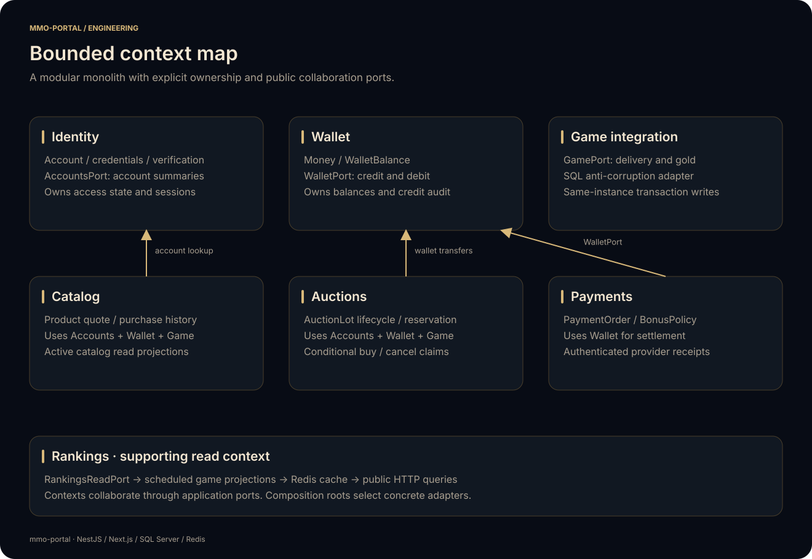
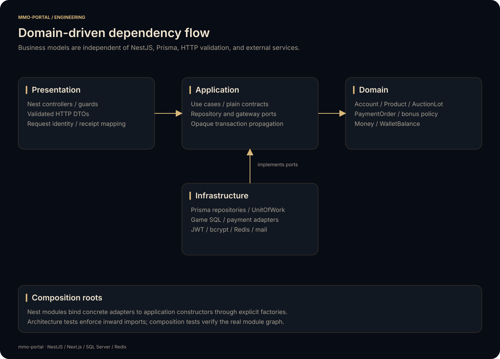

# Domain-driven design

`mmo-portal` uses a modular monolith: bounded contexts execute in one API process and collaborate through explicit application ports. The model separates account access, portal credit transfers, product purchases, player auctions, payment settlement, public rankings, and game integration.

[Architecture](ARCHITECTURE.md) · [API](../apps/api/README.md) · [Web](../apps/web/README.md)



## Context ownership and language

| Context | Domain language | Ownership | Public collaboration |
| --- | --- | --- | --- |
| Identity | Account, credential version, verification, session | Account registration, credential changes, access state, token issuance | `AccountsPort.checkUser` returns a limited account summary |
| Wallet | Credits, balance, transfer, top-up | Credit balance mutations and top-up audit records | `WalletPort` credits/debits within a caller's transaction |
| Catalog | Product, stackability, bundle, quote, purchase | Available catalog and purchase history | Catalog repository and read ports support checkout and browsing |
| Auctions | Lot, seller, buyer, reserved gold, active/completed/canceled | Listing state and ownership transitions | Auction repository conditionally persists proposed transitions |
| Payments | Order, receipt, provider, exchange rate, bonus tier | Payment order state, receipt acceptance, settlement amount | Payment repository and gateway ports; settlement calls Wallet |
| Rankings | Player ranking, competitive ranking, guild ranking | Cached read projections | `RankingsReadPort` returns public leaderboard records |
| Game integration | Item delivery, gold reservation, character state | Translation between portal operations and the game schema | `GamePort` hides SQL tables, catalog names, and game-specific rows |

A bounded context defines a model and its rules. It is not a separate deployment. Identity and Wallet currently persist different attributes of the same account table; only Identity changes credentials/access state and only Wallet changes balances. This shared database arrangement preserves existing account IDs and the game's integration contract.

## Layers and dependency direction



- **Domain:** plain TypeScript models, value objects, and policies. `Account` owns verification/reset prerequisites and registration policy; `Product` owns purchase quantity and price rules; `AuctionLot` validates lifecycle transitions; `PaymentOrder` accepts matching receipts; `BonusPolicy` selects the applicable tier; `WalletBalance` checks available funds. `Money` provides exact, bounded decimal values.
- **Application:** use cases coordinate domain decisions through repository, account, wallet, game, credential, token, notification, and payment ports. Constructors accept interfaces. Inputs and outputs are plain application contracts, separate from decorated HTTP DTO classes.
- **Infrastructure:** Prisma repositories map rows to domain models, query adapters build read projections, bcrypt/JWT implement credential/token contracts, provider adapters create payment requests, Redis caches results, and the game gateway translates delivery and gold operations.
- **Presentation:** Nest controllers, guards, request DTO validation, provider webhook normalization, and HTTP error translation. Request identity comes from authenticated server context.
- **Composition:** each context's Nest module binds concrete adapters to application constructors with factories. `AppModule` assembles contexts; `bootstrap/` composes shared runtime resources.

Domain and application source imports no NestJS, Prisma, Redis, Axios, HTTP presentation types, or concrete infrastructure. A cross-context application import targets a declared `.port.ts` contract. Architecture tests resolve local and aliased imports and enforce these rules. Composition tests compile the actual Nest modules with external resources replaced, checking the dependency graph without opening database or network connections.

## Exact monetary rules

Credits enter application/domain code as decimal strings. `Money.parse` accepts positive values up to `9000000000` with at most two fractional digits; zero is allowed explicitly for a balance. Restored balances support the full nonnegative `DECIMAL(19, 2)` persistence range independently of the single-transfer limit. Arithmetic uses an isolated `decimal.js` constructor with 50 significant digits and half-up rounding at the monetary boundary. HTTP and SQL persistence retain fixed decimal strings.

A product quote multiplies its selected unit price by a validated integer purchase count and computes the item delivery count separately. Bonus calculation keeps the unrounded converted base while selecting the highest eligible threshold, then rounds the final credited amount to two digits. A payment quote rejects a provider amount that rounds to zero.

A wallet snapshot can reject insufficient funds early. The authoritative debit still uses a conditional SQL update with `DECIMAL(19, 2)` and a sufficient-funds predicate, so concurrent requests cannot both spend the same balance.

## Application transaction protocol

`UnitOfWork.run` supplies an opaque `TransactionContext` to one scenario. The scenario passes that exact context through every participating port. `PrismaUnitOfWork` starts a transaction and creates a `PrismaTransactionContext`; concrete adapters unwrap it using a checked infrastructure helper. The domain and application do not see Prisma types.

```text
ShopService.buyShopItem
  AccountsPort.checkUser
  UnitOfWork.run(context)
    CatalogRepository.availableProduct -> Product
    Product.quote -> Money total + delivery quantity
    WalletPort.decrement(context)
    CatalogRepository.recordPurchase(context)
    GamePort.deliver(context)
  commit, or roll back every write on an exception
```

Payment settlement follows the same protocol: reconstruct the order, validate the receipt, acknowledge an existing success, calculate the bonus, conditionally claim `NEW`, and credit Wallet within the same context. Auction purchase validates the lot and buyer, conditionally claims `active`, settles both wallets, and delivers the reserved gold. Cancellation checks ownership before claiming the lot and returning gold.

Conditional repository writes remain necessary after domain validation. Two requests can read the same valid snapshot; only one may claim it. Domain objects decide whether a transition is permitted, and repositories ensure it is still permitted at write time.

Portal and GameWorld remain on the same SQL Server instance. Cross-catalog game mutations use the portal transaction connection. No remote provider HTTP call is placed inside a SQL transaction. Payment creation persists a pending order before requesting a payment link; a signed receipt later drives settlement.

These are synchronous, strongly consistent use cases. An asynchronous event bus is unnecessary for their current transaction contract. Queued email is an explicit notification adapter with retry behavior. Introducing independent databases or asynchronous financial settlement would require a separately designed delivery/outbox and compensation protocol.

## Reads and projections

Catalog browsing, active-lot lists, and rankings use dedicated read ports/adapters. They return application read models without loading aggregates solely to display a table. Rankings have no invented write aggregate: their projection adapter refreshes game queries on startup and every ten minutes and exposes the cached result through an application query facade.

Persistence rows are not exported as public domain entities. Repositories map product, lot, and payment records at their boundary. SQL names remain local to adapters, apart from established HTTP/read contract field names retained for compatibility.

## Web client boundary

`apps/web/features/` mirrors the user-facing contexts. Identity, Catalog, Auctions, Payments, and Rankings own their HTTP contracts and views; Wallet owns its balance client. Each feature has its own `infrastructure/api.ts`, while the common request transport owns base URLs, cookies, and error normalization.

The App Router, shared layouts, providers, and modal shell compose features. The backend remains authoritative for ownership, pricing, funds, and payment state. React does not import API aggregates or Prisma entities and does not reproduce financial settlement logic. The presentation and localized URLs retain their existing behavior.

## Extending a context

1. Describe the invariant in a domain model/policy and test successful and rejected decisions.
2. Define a plain application command/query and the smallest port needed by its scenario.
3. Implement persistence or an external integration behind that port. Keep concurrency predicates next to the adapter's state-changing write.
4. Bind the application constructor in the context module. Expose HTTP validation and identity extraction in presentation.
5. Add application tests for transaction propagation, failures, repeated requests, and competing claims as applicable.
6. Update the context README, diagrams, web contracts, and migration when their contract changes.

Run `pnpm --dir apps/api exec jest --runInBand` to execute domain policies, orchestration/adapter tests, architecture rules, and composition verification. These tests use deterministic doubles for SQL, Redis, SMTP, and payment APIs. Production builds and container checks verify packaging; live integration environments validate operator-specific game schemas and provider configuration.
